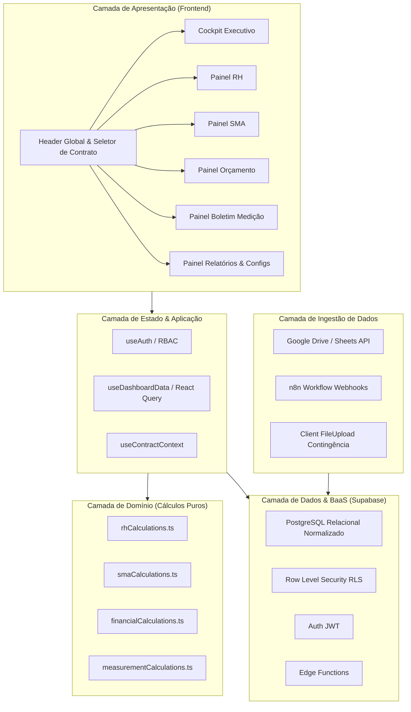

# Documento de Arquitetura de Software
## Plataforma de Business Intelligence para Facilities (DNA Facilities)

---

## 1. Diagnóstico da Arquitetura Atual

A análise detalhada do código-fonte existente em `dashboard-gestaoavista-main` revelou os seguintes pilares arquiteturais:

### 1.1. Pontos Fortes da Implementação Existente
1. **Design System Consistente**: O arquivo [index.css](file:///c:/Antigravity/dashboard-gestaoavista-main/src/index.css) e o [tailwind.config.ts](file:///c:/Antigravity/dashboard-gestaoavista-main/tailwind.config.ts) estabelecem uma identidade visual dark corporativa sólida ("DNA Facilities Dark Theme"), com paleta HSL estruturada, gradientes sutis e sombras elegantes.
2. **Componentização Base**: Excelente adoção de componentes primitivos acessíveis via **Radix UI** / shadcn/ui.
3. **Autenticação e RLS no Banco**: Migração recente (`20251016172132`) implementando `user_roles` com enum `app_role ('admin', 'manager', 'user')`, funções de segurança (`has_role`, `is_user_manager_or_admin`) e Row Level Security.
4. **Sanitização de Upload**: O componente [FileUpload.tsx](file:///c:/Antigravity/dashboard-gestaoavista-main/src/components/dashboard/FileUpload.tsx) já possui validação de extensão, tamanho máximo de 10MB e higienização básica de caracteres contra path traversal.

### 1.2. Lacunas e Débitos Técnicos Identificados
1. **Armazenamento Não-Relacional (JSON Blob)**:
   - Os dados importados são gravados em uma coluna genérica `data: json` na tabela `dashboard_data`.
   - **Impacto**: Impossibilita consultas agregadas em SQL (`GROUP BY`, `SUM`, `AVG`), inviabiliza integridade referencial entre contratos e colaboradores, e limita a performance quando o volume cresce.
2. **Cálculos de Negócio Embutidos em Componentes Visuais**:
   - Componentes como [KPICards.tsx](file:///c:/Antigravity/dashboard-gestaoavista-main/src/components/dashboard/KPICards.tsx), [RHIndicators.tsx](file:///c:/Antigravity/dashboard-gestaoavista-main/src/components/dashboard/RHIndicators.tsx) e [OrcadoRealizadoChart.tsx](file:///c:/Antigravity/dashboard-gestaoavista-main/src/components/dashboard/OrcadoRealizadoChart.tsx) realizam parsing de strings monetárias (`.replace(/[R$\s.]/g, '')`) e agrupamentos em memória no cliente.
   - **Impacto**: Duplicação de lógica, risco de discrepâncias matemáticas e dificuldade de testes automatizados isolados.
3. **Estrutura de Diretórios Duplicada**:
   - Foi identificada uma pasta `c:\Antigravity\src` na raiz e a pasta `c:\Antigravity\dashboard-gestaoavista-main\src`. A aplicação funcional e as dependências completas estão na pasta `dashboard-gestaoavista-main`.
4. **Escopo Funcional Parcial**:
   - Atualmente existem apenas 3 abas na interface ("Visão Geral", "Orçado x Realizado" e "Indicadores RH"). Faltam as páginas completas de **SMA**, **Boletim de Medição**, **Relatórios Gerenciais** e a expansão da página de **Configurações**.

---

## 2. Arquitetura Proposta (Target Enterprise Architecture)

A arquitetura alvo preserva os investimentos já feitos no ecossistema Vite + React + Tailwind + Supabase, evoluindo o modelo de dados e a organização em camadas.

### 2.1. Visão de Camadas

---

## 3. Ambientes e Governança de Configuração

- **Desenvolvimento Local**:
  - Servidor Vite: `npm run dev` na porta local 8080 ou 5173.
  - Conexão com instância Supabase de desenvolvimento ou staging.
- **Homologação**:
  - Ambiente protegido para conferência de cálculos com os gestores de contratos de RH, SMA e Financeiro.
- **Produção**:
  - Hospedagem na Vercel com deploy automatizado via branch `main`.
  - Supabase com backups diários e PITR (Point-in-Time Recovery) ativado.
