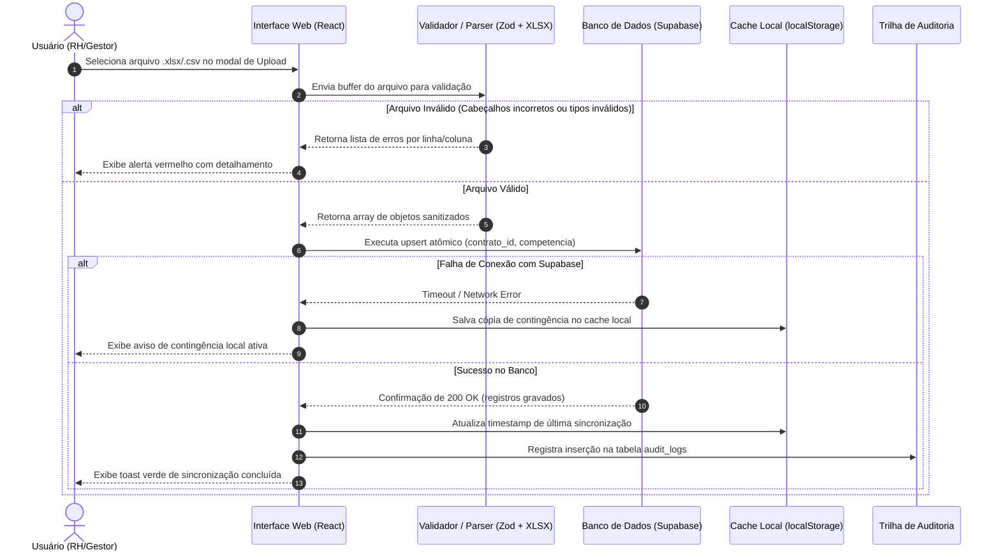
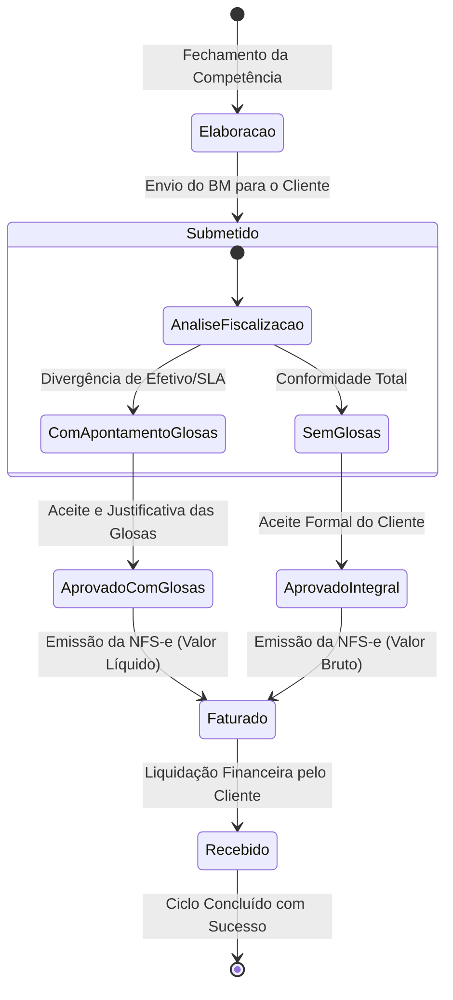
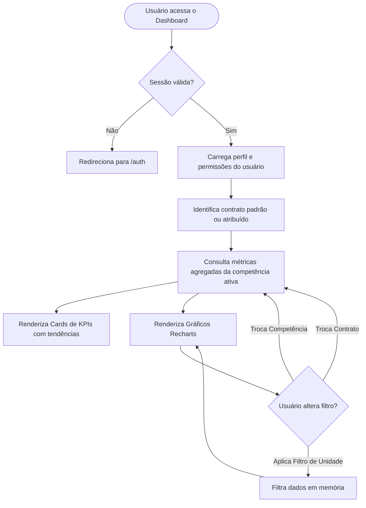

# Diagramas de Processos, Arquitetura e Ciclo de Vida
## Plataforma de Business Intelligence para Facilities (DNA Facilities)

---

## 1. Diagrama de Sequência — Ingestão e Processamento de Planilhas

---

## 2. Diagrama de Estados — Ciclo de Vida do Boletim de Medição (BM)

---

## 3. Diagrama de Atividades — Consulta Interativa do Dashboard

