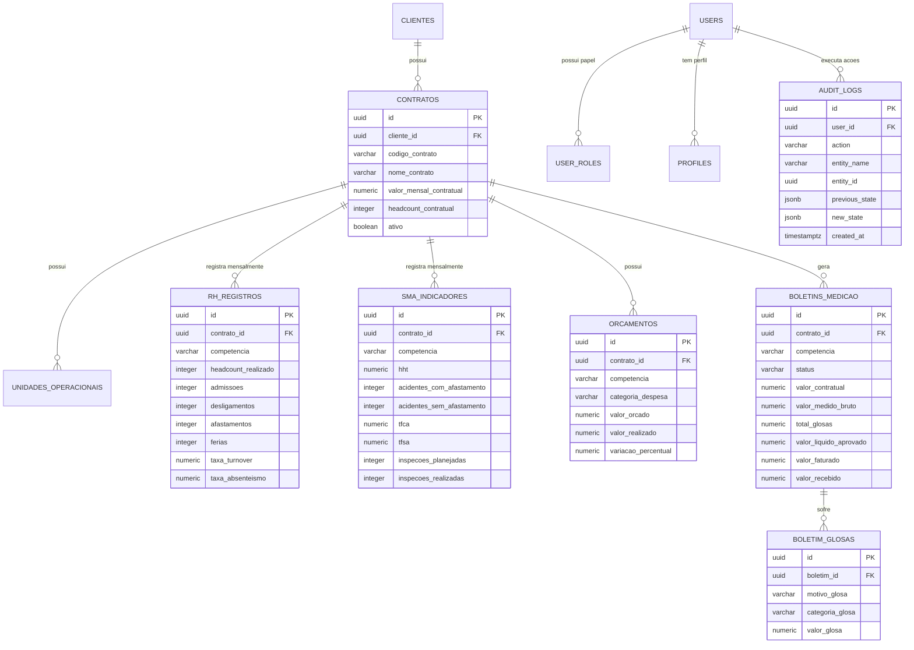

# Modelo Entidade-Relacionamento (MER / DER)
## Plataforma de Business Intelligence para Facilities (DNA Facilities)

---

## 1. Diagrama Entidade-Relacionamento (Mermaid ER)



---

## 2. Índices de Alta Performance Recomendados

Para manter tempo de resposta inferior a 200ms nas consultas do dashboard:

```sql
-- Índices para buscas rápidas por contrato e competência
CREATE INDEX IF NOT EXISTS idx_rh_contrato_comp ON public.rh_registros_competencia (contrato_id, competencia);
CREATE INDEX IF NOT EXISTS idx_sma_contrato_comp ON public.sma_indicadores (contrato_id, competencia);
CREATE INDEX IF NOT EXISTS idx_orc_contrato_comp ON public.orcamentos_competencia (contrato_id, competencia);
CREATE INDEX IF NOT EXISTS idx_bm_contrato_comp ON public.boletins_medicao (contrato_id, competencia);

-- Índice para trilha de auditoria cronológica
CREATE INDEX IF NOT EXISTS idx_audit_created ON public.audit_logs (created_at DESC);
```
